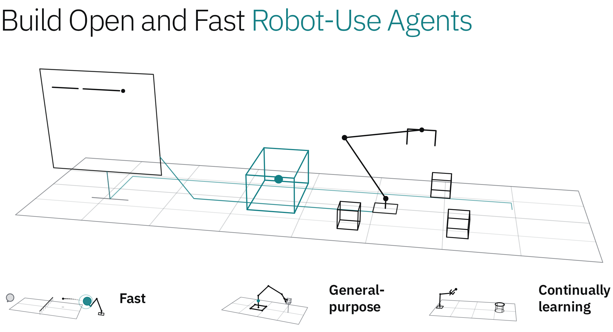

  <a href="https://fastrua.ai/"><picture><source media="(prefers-color-scheme: dark)" srcset="https://raw.githubusercontent.com/fast-rua/.github/main/profile/assets/profile-dark.png"><source media="(prefers-color-scheme: light)" srcset="https://raw.githubusercontent.com/fast-rua/.github/main/profile/assets/profile-light.png"></picture></a>

  Language models that operate robots through tools and programs. From <a href="https://haoailab.com/">Hao AI Lab</a> at UC San Diego. 
  <a href="https://fastrua.ai/"><strong>Website</strong></a> · <a href="https://fastrua.ai/blog/">Blog</a> · <a href="https://fastrua.ai/ora/gallery/">Gallery</a> · <a href="https://fastrua.ai/ora/docs/">Docs</a>

- **[ORA](https://github.com/fast-rua/ORA)**: an open harness that lets a language model operate a robot, zero-shot. [Site](https://fastrua.ai/ora/) · [v0.1 post](https://fastrua.ai/blog/2026-11-code-mode/) · [Paper](https://openreview.net/forum?id=Z3d0gg7uU0)
- **[Making RUA fast](https://github.com/fast-rua/making-rua-fast)**: robot-use agents in real time on a two-arm robot. [Post](https://fastrua.ai/blog/2026-11-realtime-rua/)
