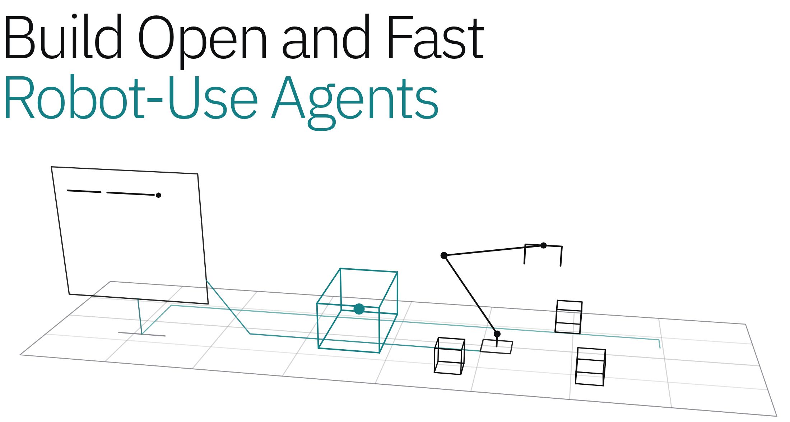
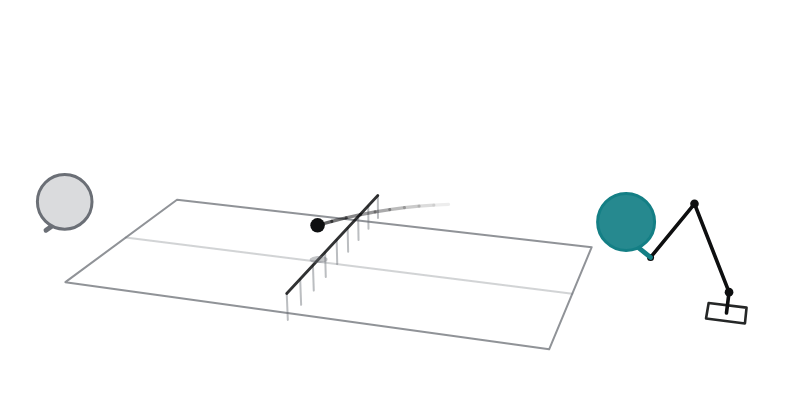
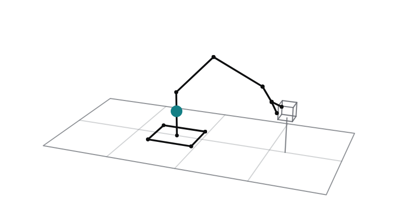
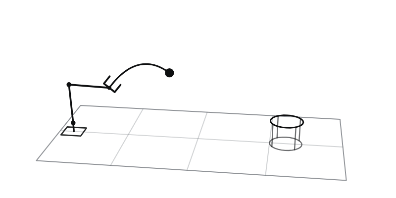

  <a href="https://fastrua.ai/"><picture><source media="(prefers-color-scheme: dark)" srcset="https://raw.githubusercontent.com/fast-rua/.github/main/profile/assets/banner-dark.png"><source media="(prefers-color-scheme: light)" srcset="https://raw.githubusercontent.com/fast-rua/.github/main/profile/assets/banner-light.png"></picture></a>

  <strong>FastRUA</strong> builds open and fast robot-use agents: language models that operate robots through tools and programs. 
  From <a href="https://haoailab.com/">Hao AI Lab</a> at UC San Diego.

  <a href="https://fastrua.ai/"><strong>Website</strong></a> ·
  <a href="https://fastrua.ai/blog/">Blog</a> ·
  <a href="https://fastrua.ai/ora/">ORA</a> ·
  <a href="https://fastrua.ai/ora/gallery/">Gallery</a> ·
  <a href="https://fastrua.ai/ora/docs/">Docs</a>

## What we want to build

Robot-use agents that are

<table>
<tr>
<td width="33%" valign="top"><picture><source media="(prefers-color-scheme: dark)" srcset="https://raw.githubusercontent.com/fast-rua/.github/main/profile/assets/aim-fast-dark.png"><source media="(prefers-color-scheme: light)" srcset="https://raw.githubusercontent.com/fast-rua/.github/main/profile/assets/aim-fast-light.png"></picture> <strong>Fast</strong> They work in real time: you can talk to them mid-task, and they notice when the scene changes.</td>
<td width="33%" valign="top"><picture><source media="(prefers-color-scheme: dark)" srcset="https://raw.githubusercontent.com/fast-rua/.github/main/profile/assets/aim-general-dark.png"><source media="(prefers-color-scheme: light)" srcset="https://raw.githubusercontent.com/fast-rua/.github/main/profile/assets/aim-general-light.png"></picture> <strong>General-purpose</strong> One agent across robot bodies, scenes and tasks nobody scripted.</td>
<td width="33%" valign="top"><picture><source media="(prefers-color-scheme: dark)" srcset="https://raw.githubusercontent.com/fast-rua/.github/main/profile/assets/aim-learn-dark.png"><source media="(prefers-color-scheme: light)" srcset="https://raw.githubusercontent.com/fast-rua/.github/main/profile/assets/aim-learn-light.png"></picture> <strong>Continually learning</strong> They pick up new tasks and environments from a demonstration, or by practising on their own.</td>
</tr>
</table>

## Projects

**[ORA](https://fastrua.ai/ora/), Open Robot-Use Agents.** An open harness that lets a language model operate a robot through camera images and tools: open-weight models, zero-shot, with no VLA and no robot training. ORA v0.1 solves 39.9% of RoboDojo with DeepSeek-V4.1-Flash. [Code](https://github.com/hao-ai-lab/ORA) · [Docs](https://fastrua.ai/ora/docs/) · [Gallery](https://fastrua.ai/ora/gallery/) · [Paper](https://openreview.net/forum?id=Z3d0gg7uU0)

**[Making RUA fast](https://github.com/fast-rua/making-rua-fast).** Robot-use agents in real time on a two-arm YAM cell: with fewer round trips and pipelining, the same task takes 204 s where it took 667 s. [Code](https://github.com/fast-rua/making-rua-fast) · [Post](https://fastrua.ai/blog/2026-11-realtime-rua/)

## Posts

- Nov 2026 · [ORA v0.1: Robot-use agents now write code, move smoothly, and reach 40% on RoboDojo](https://fastrua.ai/blog/2026-11-code-mode/)
- Nov 2026 · [Getting Robot-Use Agents to Run in Real Time](https://fastrua.ai/blog/2026-11-realtime-rua/)
- Oct 2026 · [Introducing ORA: Open Robot-Use Agents Zero-Shot Solve Robot Tasks](https://fastrua.ai/blog/2026-10-ora/)
